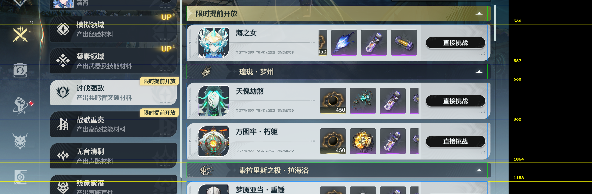
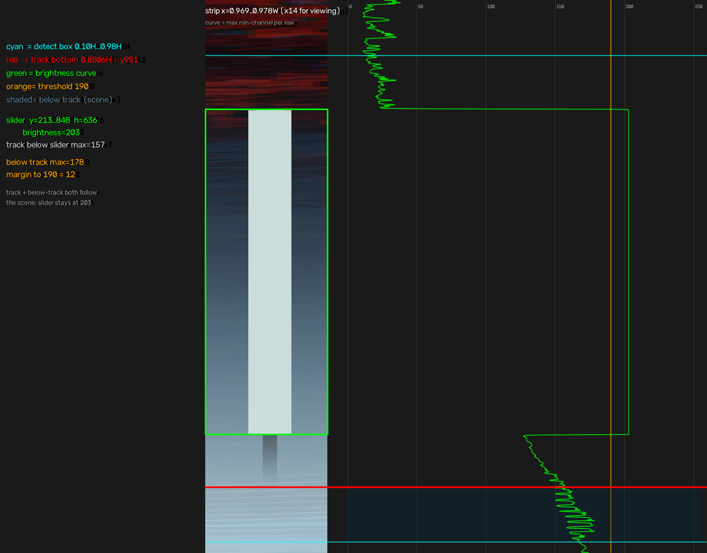
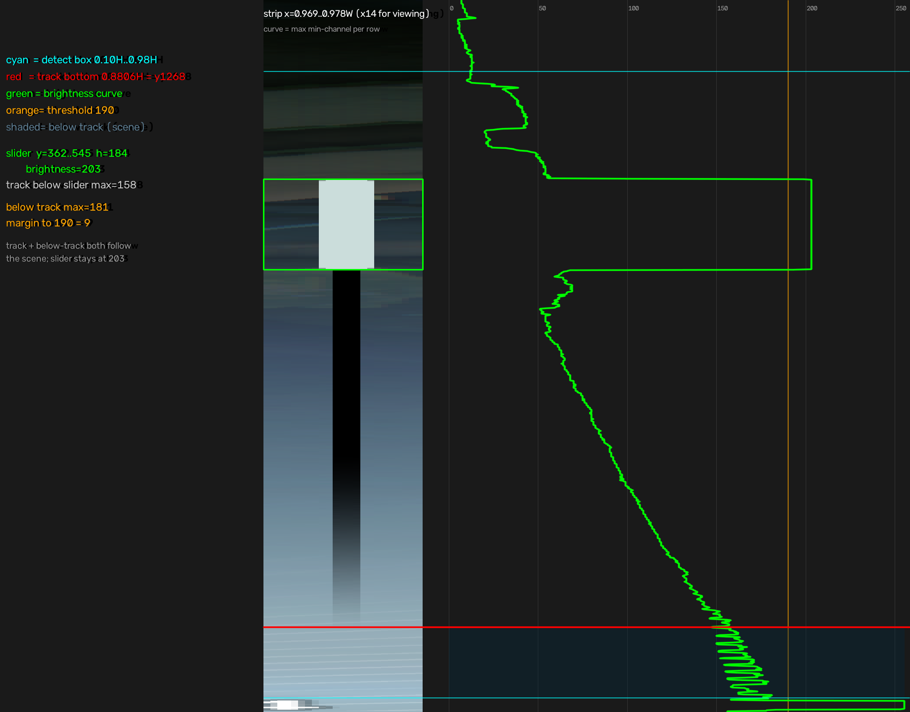
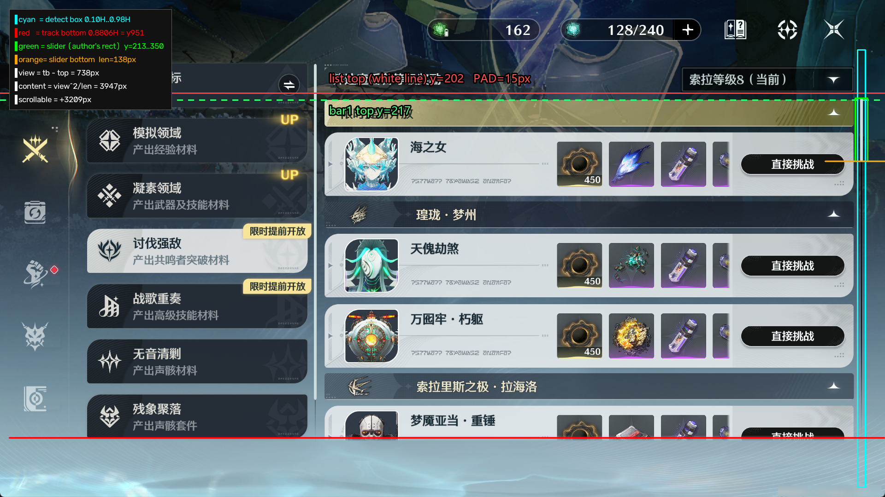
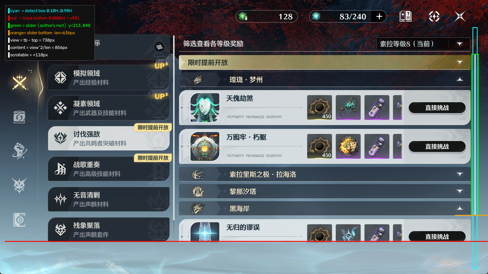
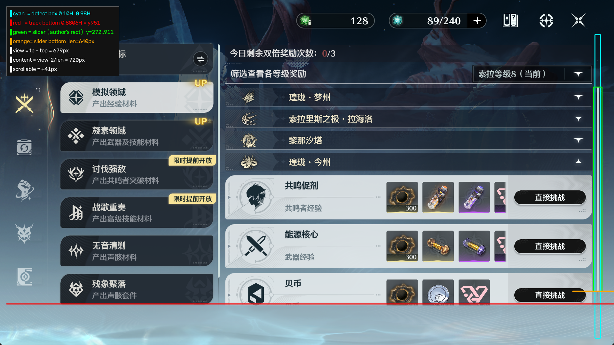
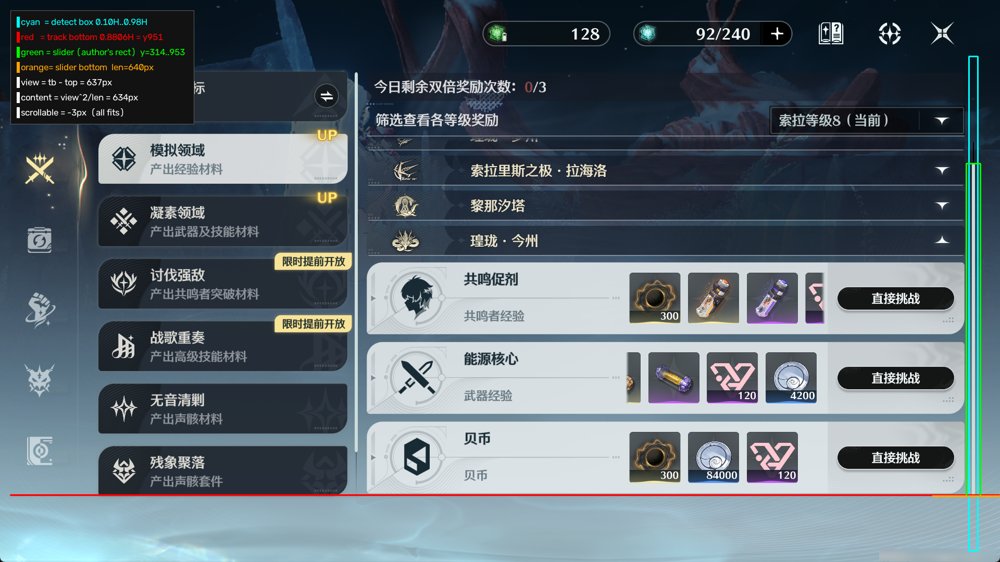
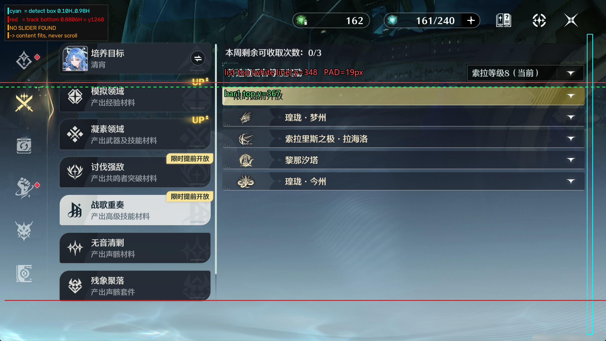
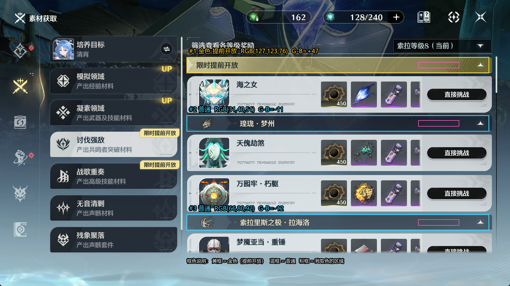
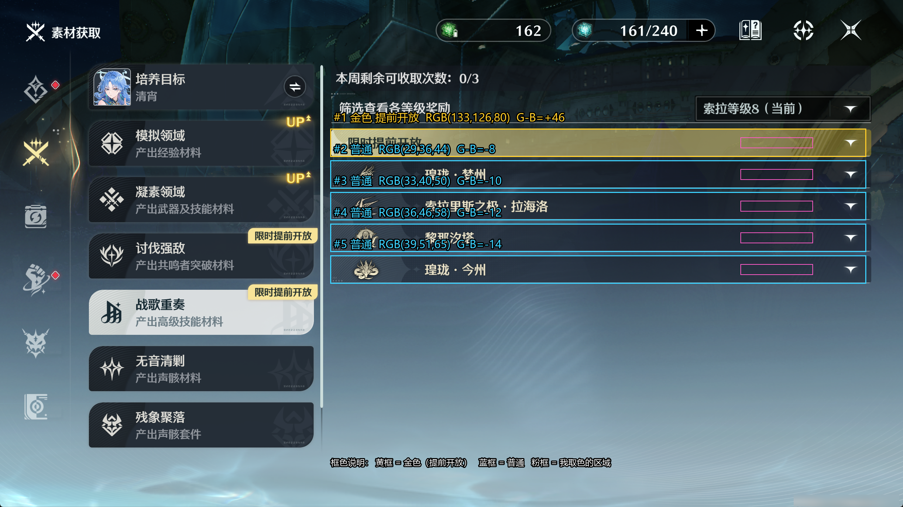

# 04 · 实测几何：区域栏 / 副本卡片 / 箭头

全部数字来自实际截图逐像素量取，不是拟合、不是照抄作者常量。
坐标原点 = 截图左上角，单位 = 物理像素。

测量素材（原始截图属本地运行时产物，已在 `.gitignore` 中）：

| 文件 | 尺寸 | 页面状态 |
|---|---|---|
| `screenshots/…_1920x1080_1792318267478…png` | 1920×1080 | 凝素领域，**展开态**（有卡片） |
| `screenshots/…_2560x1440_1792325813762…png` | 2560×1440 | 同上，**展开态**，用于跨分辨率校验 |
| `screenshots/…_2560x1440_1792330058546…png` | 2560×1440 | 全部区域**收起态**（无卡片） |

---

## 一、元素定义

列表由两类元素交替组成：

| 元素 | 代号 | 说明 |
|---|---|---|
| 区域栏 | `bar` | 横向通栏，左侧区域名，右侧箭头。分为**金色（提前开放）** 和 **普通** 两类，流程不同，见 5.3 |
| 副本卡片 | `card` | 单个副本条目，含图标、名称、掉落、"直接挑战"按钮 |

---

## 二、1080p 展开态锚点

| 元素 | 首行 | 末行 | 高度 |
|---|---|---|---|
| `bar` #1 | 217 | 274 | 58 |
| `card` #1 | 288 | 425 | 138 |
| `bar` #2 | 437 | 494 | 58 |
| `card` #2 | 508 | 645 | 138 |
| `card` #3 | 661 | 798 | 138 |
| `bar` #3 | 811 | 868 | 58 |
| `card` #4 | 882 | 1019 | 138 |

标注图（金框 = 区域栏，蓝框 = 卡片，黄线 = 实测边界行）：


行宽统一：左边界 `x=704`，右边界 `x=1840`；箭头横坐标固定 `x=1809`（0.9422 屏宽）。

> **±1 px 提醒**：元素相邻处有 1 行抗锯齿过渡，`bar` 底边还有 1~2 行亮边线归属歧义。
> 上表统一取「填充色最后一行（含亮边线）」。
> 高度 `58 / 138` 在 3~4 处独立锚点上零误差，这个才是硬约束。

---

## 三、模型

### 3.1 常量（全部是比例，不写死像素）

| 量 | 符号 | 1080p 值 | 占窗高比 |
|---|---|---|---|
| 区域栏高 | `BAR_H` | 58 | 0.05370 |
| 卡片高 | `CARD_H` | 138 | 0.12778 |
| bar→card 间距 | `G1` | 13 | 0.01204 |
| card→bar 间距 | `G2` | 12 | 0.01111 |
| card→card 间距 | `G3` | 15 | 0.01389 |
| 卡片节距 | `CARD_PITCH` | 153 | 0.14167 |
| **收起态栏节距** | `BAR_PITCH_C` | 67.5 | **0.06250** |
| 收起态栏间距 | `G_C` | 9.75 | 0.00903 |
| 箭头横坐标 | `ARROW_X` | 1809 | 0.94219 屏宽 |

间距定义唯一：**两个元素边界之间的空行数**（不含任一元素的边线行）。

### 3.2 运行时代码

```python
h = frame_height          # 截图像素高
bar_top(N)    = bar_top(1) + Σ_{k<N} ( BAR_H*h + G1*h + n_k*CARD_H*h + (n_k-1)*G3*h + G2*h )
card_top(N,M) = bar_top(N) + BAR_H*h + G1*h + (M-1)*CARD_PITCH*h
click_y       = bar_top(N) + BAR_H*h/2
click_x       = ARROW_X*w
```

**关键：全程用 float 累计，只在最后取整一次**；逐跳取整会累积漂移。

`n_k` = 第 k 个区域展开时可见的卡片数。**这个数代码不知道**，正是 v2 方案要用「先全部收起」消掉它的原因。

### 3.3 校验

| 预测 | 实测 | 差 |
|---|---|---|
| `card_top(1,1) = 217+58+13 = 288` | 288 | 0 |
| `card_top(2,1) = 437+58+13 = 508` | 508 | 0 |
| `card_top(3,1) = 811+58+13 = 882` | 882 | 0 |
| `card_top(2,2) = 508+153 = 661` | 661 | 0 |
| `bar_top(2) = 288+138+12 = 438` | 437 | −1 |
| `bar_top(3) = 798+1+12 = 811` | 811 | 0 |

**唯一偏差**是 `bar#2` 顶边比模型早 1 px（`bar#1` 的卡片底边有 1 px 抗锯齿过渡行）。
`bar_top(3) - bar_top(2) = 374`，而 `220 + 153 = 373`，同样差这 1 px。
属于子像素取整，**不是常量错**。

### 3.4 与作者常量的对应关系

| 作者常量 | 值 | 实测对应 |
|---|---|---|
| `row_h` | `0.0708 * 2160 = 152.9` | **`CARD_PITCH = 153`** 完全一致 |
| `header_h` | 未在几何里出现 | 仅用于估算，本次不使用 |
| `container_max_rows = 4` | 首屏整屏可见的卡片数 | 本方案不使用 |

即作者的 `row_h` 早就等于「卡片高 + 卡片间距」，是**对的**；
出错的不是它，而是喂给它的 `total_number`（写死 9/20，实际 11/23）。

### 3.5 展开态的分辨率缩放

`bar_top(1)` 的亮块中心在两份截图上都是 **0.1972**（1080p → 213、1440p → 284）。

1440p 按 ×4/3 缩放后的模型值 vs 实测：

| 边界 | 模型 | 实测 | 差 |
|---|---|---|---|
| bar#1 顶 | 289 | 289 | 0 |
| card#1 顶 | 384 | 384 | 0 |
| card#1 底 | 567 | 567 | 0 |
| bar#2 顶 | 583 | 583 | 0 |
| card#2 顶 | 677 | 677 | 0 |
| card#2 底 | 860 | 861 | 1 |
| card#3 顶 | 881 | 882 | 1 |
| bar#3 顶 | 1081 | 1082 | 1 |
| card#4 顶 | 1176 | 1176 | 0 |

误差 ≤1 px，**没有随分辨率放大**。



### 3.6 收起态几何

1440p 收起截图（5 根栏、无卡片）：

| 栏 | 首行 | 末行 | 箭头中心 |
|---|---|---|---|
| #1 限时提前开放 | 367 | 443 | 405 |
| #2 琼珑·梦州 | 457 | 533 | 495 |
| #3 索拉里斯之极·拉海洛 | 547 | 623 | 585 |
| #4 黎那汐塔 | 637 | 713 | 675 |
| #5 琼珑·今州 | 727 | 803 | 765 |

- **栏节距恒为 90 px**（= 0.0625 H，正好 1/16），5 根栏零漂移
- 栏高 77 px（367..443），与展开态 `58 × 4/3 = 77.3` 一致
- 收起时间距 = `90 − 77 = 13 px`（= 0.00903 H，1080p 下 9.75 px）
- 第 1 根栏上方 `y=347~350` 有一条亮横线（列表容器顶边框），**不要误当栏顶**

→ 「全部收起」确实是一个**等间距、可预测的基准态**，v2 的前提成立。

---

## 四、列表顶端定位（作者方法，已验证可用）

`_find_book_scroll_top()`：在窄条 `x∈(0.969, 0.978)`、`y∈(0.191, 0.271)` 内找**最亮横块**，取上边 y。

| 分辨率 | 亮块范围 | 归一化 |
|---|---|---|
| 1080p | `y=213..291, x=1866..1871` | 0.1972 |
| 1440p | `y=284..389, x=2488..2495` | 0.1972 |

- 该值是**滚动条滑块顶边**，滑块在顶部时 = 第一根栏的顶边
- 归一化值分辨率无关，一份常量够用
- 列表不在顶部时该值变小 → 可作「是否已滚到顶」的判据

### 4.1 滑块几何（长滑块 / 轨道底部渐变）

滑块的 **top 和 bottom 都来自作者现成的 `find_color_rectangles`**：
在窄条 `x∈[0.969,0.978]W`、`y∈[0.10,0.98]H` 内找 `book_bar_color`（三通道 ≥190）的矩形，
取最高的那个，`.y` 是顶、`.y + .height - 1` 是底。**不二分、不逐行扫描、不另写判据。**

六张实测截图，与逐行扫描测得的真值**全部零误差**：

| 截图 | 滑块 top..bottom | 长度 | 真值 | 误差 | 轨道底 | 可见区 |
|---|---|---|---|---|---|---|
| 1080p 短滑块 | 213..350 | 138 | 213..350 | 0 / 0 | 951 | 738 |
| 1080p 长滑块 | 213..848 | 636 | 213..848 | 0 / 0 | 951 | 738 |
| 1080p 中段 | 272..911 | 640 | 272..911 | 0 / 0 | 951 | 679 |
| 1080p 贴底 | 314..953 | 640 | 314..953 | 0 / 0 | 951 | 637 |
| 1440p 长滑块 | 362..545 | 184 | 362..545 | 0 / 0 | 1268 | 906 |
| 1440p 全收起 | 无矩形 | — | — | — | 1268 | 0（不滚） |

**「贴底」这一张是最极限的**：滑块底 `953` 已经越过写死的轨道底 `951` 两个像素。
按 `content = view²/len` 算得 `634 < view 637`，即 `scrollable = -3`，
说明内容一屏装得下，`to_bottom > view` 永不成立，**滚动分支根本不会进入**。
所以这个 ±2px 的几何误差不影响任何实际路径。

> 曾经试过用「二分找第一个全灭行」来算滑块底，实测在 4 张图上与真值一致，
> 但在「贴底」那张上算成 950（真值 953）。既然作者的矩形检测在 6 张图上都是零误差，
> 就没必要自己写判据了 —— 少 20 行代码，还更准。

### 4.2 阈值余量（`book_bar_color` 三通道 ≥190）

| 区域 | 亮度 |
|---|---|
| 滑块（恒定，不随环境变） | **203** |
| 轨道内、滑块以下 | ≤158 |
| 轨道底以下（已是场景） | ≤181 |

余量 12~14。做了两组压力测试：

| 操作 | 背景/轨道提亮 | 结果 |
|---|---|---|
| 只提亮滑块两侧背景列 | +60（→238，比滑块还亮 35） | 仍正确 |
| 只提亮滑块以下轨道 | +50（→207） | 仍正确 |
| 背景提到 255 | — | 检测失败（返回 None，不是误判成更长的滑块） |

**宽度是关键**：滑块 6px（1080p）/ 8px（1440p）实心，轨道只有 2px 细线，背景在两侧。
`find_color_rectangles` 要求矩形内 80% 像素命中，背景再亮也连不成片。

滑块横截面（1080p，`x=1866..1871` 共 6 列）逐行白列占比：

| 位置 | 白列数 | 占比 |
|---|---|---|
| 主体 | 5 / 6 | **0.83** |
| 底边倒数第 2 行 | 4 / 6 | 0.67 |
| 底边最后一行 | 2 / 6 | 0.33 |
| 再下一行 | 0 / 6 | 0.00 |

主体只到 0.83 而非 1.0，因为 6 列里有 1 列是轨道细线 —— 这正是作者用 **80%** 而不是
「全命中」的原因，也说明 80% 这个门槛是合适的。

> 顺带记录：`frac >= 0.8` 这个逐行判据**不单调**（圆角导致顶部和底部都低于 0.8，
> 只有中间一段为真），所以它不能直接拿去做二分。而作者的矩形检测是在整块上算一次
> 占比，没有这个问题。





剖面图：左为 `x∈[0.969,0.978]W` 窄带（横向拉伸仅供观看），右为逐行最大亮度曲线；
绿框=滑块，红线=轨道底 0.8806H，青线=检测框上下沿，橙线=阈值 190，阴影=轨道底以下的场景区。

### 4.3 滑块检测验证图











标注：青框=检测框，红线=轨道底 0.8806H，绿框=作者矩形检测出的滑块，
橙线=滑块底。左上角面板给出 `view / content / scrollable` 三个派生量。

---

## 五、箭头

### 5.1 只识别 ▲，不识别 ▼

| 状态 | 字形 | 本方案是否识别 |
|---|---|---|
| 展开 | **▲** 实心正三角，尖端朝上 | **是**，只识别这一种 |
| 收起 | **▼** 实心倒三角，尖端朝下 | **否** |

不识别 ▼ 的理由：没有任何地方需要它。
给出收起态截图的目的只有一个——**验证 ▲ 模板不会把 ▼ 误识别成展开**。

实测：

| 模板 \ 图像 | 展开图 | 收起图 |
|---|---|---|
| ▲ 模板（36×36） | 0.958 ~ 1.000 | **0.636（最高）** |

差距 0.32，▲ 模板对 ▼ 完全不响应 → 用 ▲ 模板的前提成立。

> 顺带说明：页面右上「索拉等级 8（当前）」下拉框的箭头也是 ▼，
> 但因为本方案从不匹配 ▼，**不存在与它冲突的问题**。

### 5.2 ▲ 的形态与位置

- 实心正三角，尖端朝上，非空心 chevron
- 1080p 有效尺寸 宽 28 × 高 14，中心 `(1809, 242.5)`
- 栏中线 `bar_top + BAR_H/2 = 246`，与箭头中心差 3.5 px（三角视觉重心偏下）
- 点击用栏中线即可，落在字形内部

### 5.3 背景：两类，用取色 + 判据分类

**只有两类**：金色（限时提前开放）与普通。逐栏取色（取栏内 `x∈[0.82,0.90]W`、
栏中段 30%~70% 高度的中位数，避开字形与辉光）：

| 截图 | 栏 | RGB | `G − B` | 类别 |
|---|---|---|---|---|
| 1080p 展开 | #1 | (127,123,76) | **+47** | 金色 |
| 1080p 展开 | #2 | (31,40,51) | −11 | 普通 |
| 1080p 展开 | #3 | (66,80,92) | −12 | 普通 |
| 1440p 收起 | #1 | (133,126,80) | **+46** | 金色 |
| 1440p 收起 | #2 | (29,36,44) | −8 | 普通 |
| 1440p 收起 | #3 | (33,40,50) | −10 | 普通 |
| 1440p 收起 | #4 | (36,46,58) | −12 | 普通 |
| 1440p 收起 | #5 | (39,51,65) | −14 | 普通 |

**判据：`G − B > 15` → 金色，否则普通。** 两类间隔 60 以上，噪声完全吃不掉。

普通栏之间的像素差异（−8 到 −14、亮度 29→39）是**半透明栏叠在不同 3D 场景上**造成的，
属于同一类内部的亮度浮动，**不构成第三种颜色**。

标注图（黄框 = 金色，蓝框 = 普通，粉框 = 我取色的区域）：





### 5.4 为什么必须分类：金色栏的流程不同

金色（限时提前开放）区域在展开后**多一个按钮需要点击，之后还要做 OCR**，
普通区域没有这一步。所以需要在点开区域前先判定栏的颜色，走不同分支。

**分类用「取色 + 判据」，不用模板匹配**——模板匹配是先减均值的相对比较，
反而丢掉了绝对色相信息。

### 5.5 模板不要带底色（透明 + 加噪实测）

把 ▲ 字形按亮度提成 alpha，合成到 8 种实测底色上，叠加高斯噪声，
分别用「32×32 含底色模板」和「24×12 纯字形模板」匹配，取 8 种底色的最差得分：

| 噪声 σ | 32×32 含底色 | 24×12 纯字形 |
|---|---|---|
| 0 | 0.948 | 0.948 |
| 5 | 0.943 | 0.945 |
| 10 | 0.921 | 0.939 |
| 20 | 0.767 | 0.884 |

含底色在极端亮底 + 强噪声时掉到 0.77；纯字形仍有 0.88。
底色会随场景变化，属于**噪声源**不是**特征** → 模板只取字形。

### 5.6 跨分辨率识别实测

| 方向 | bar#1 | bar#2 | bar#3 |
|---|---|---|---|
| ▲ 1080p 模板 ×4/3 → 1440p 图 | 0.991 | 0.975 | 0.971 |
| 1440p 图取模板 → 缩到 1080p → 1080p 图 | 0.990 | 0.960 | 0.969 |

**可以跨分辨率识别**，不需要按分辨率各做一套模板。
框架 `FeatureSet.adjust_coordinates()` 在加载时按
`min(screen_w/img_w, screen_h/img_h)` 缩放模板并按边锚定，所以**只做一套 1080p 资源**。

实测位置误差 2~3 px，来源是 `32 × 4/3 = 42.67 → 43`（奇数取整）。
模板尺寸取偶数即可。

### 5.7 已产出的文件（`docs/images/`）

| 文件 | 尺寸 | 说明 |
|---|---|---|
| `arrow_expanded_36.png` | 36×36 | ▲ 模板（1080p），**唯一要用的箭头模板** |
| `arrow_collapsed_36.png` | 36×36 | ▼ 样本，仅作负样本验证，不参与识别 |
| `arrow_collapsed_1440.png` | 48×48 | ▼ 的 1440p 原生裁剪（备查） |
| `arrow_gold_28.png` | 28×28 | 金底版，仅作 5.5 对照 |
| `arrow_dark_28.png` | 28×28 | 深底版，仅作 5.5 对照 |
| `class_1080p_expanded.png` | 1920×1080 | 5.3 底色分类标注图 |
| `class_1440p_collapsed.png` | 2560×1440 | 5.3 底色分类标注图 |

---

## 六、尚未实测（必须跑游戏才能确定）

1. **拖拽像素 → 列表滚动像素的映射系数**。
2. **拖拽在 `PostMessage` 后台模式下的可靠性**（`swipe` 内含 `try_activate()`）。
3. **收起/展开的点击是否即时生效**（有无动画延迟，影响下一步等待时长）。
4. **金色栏多出来的那个按钮**：位置、是否需要 OCR、OCR 取什么内容。
